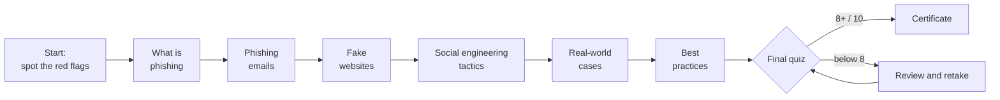
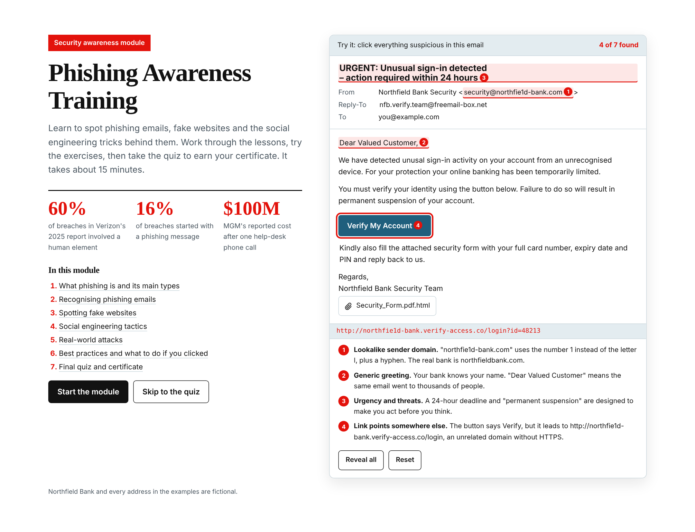
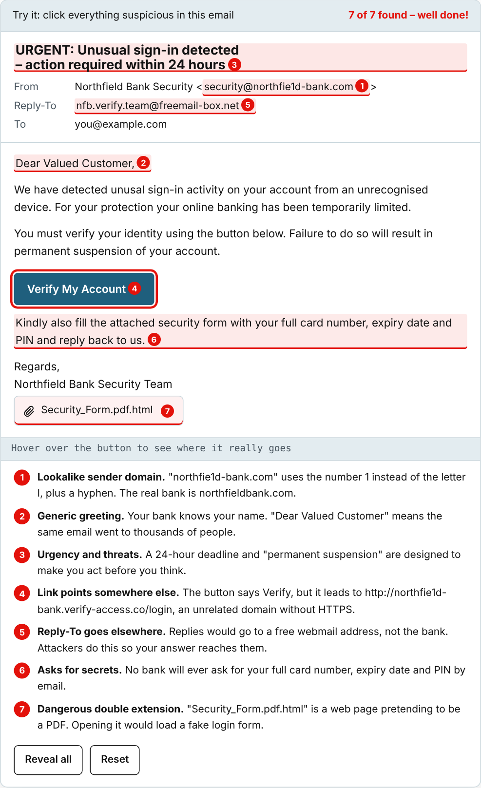
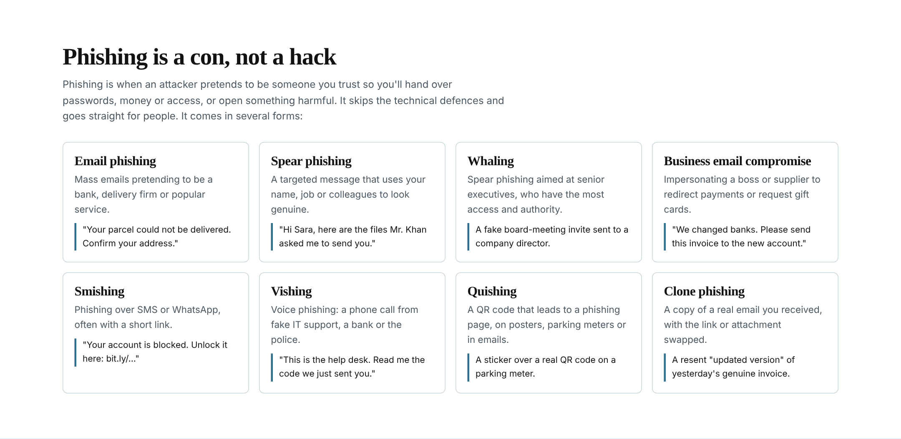
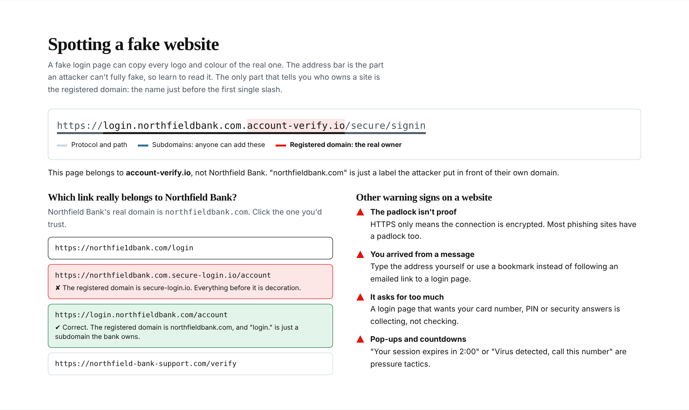
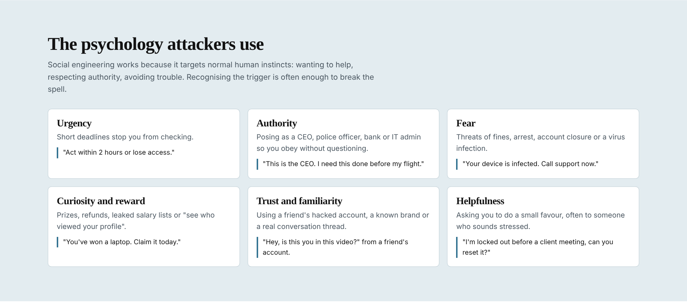
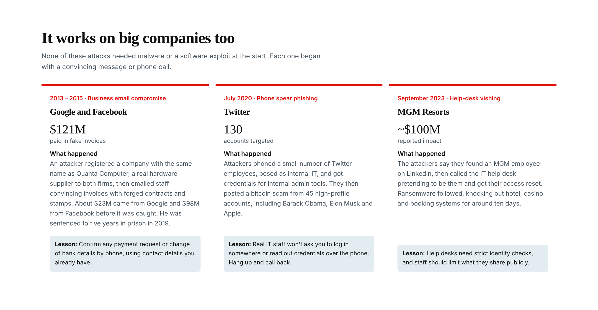
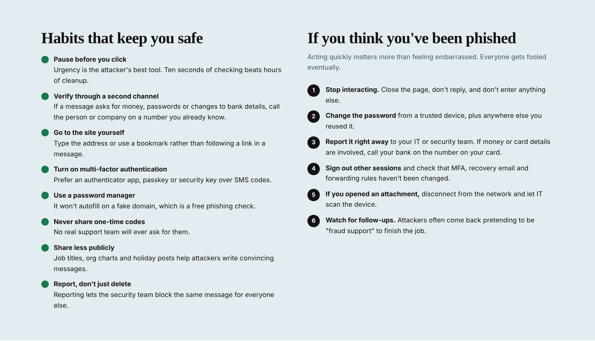
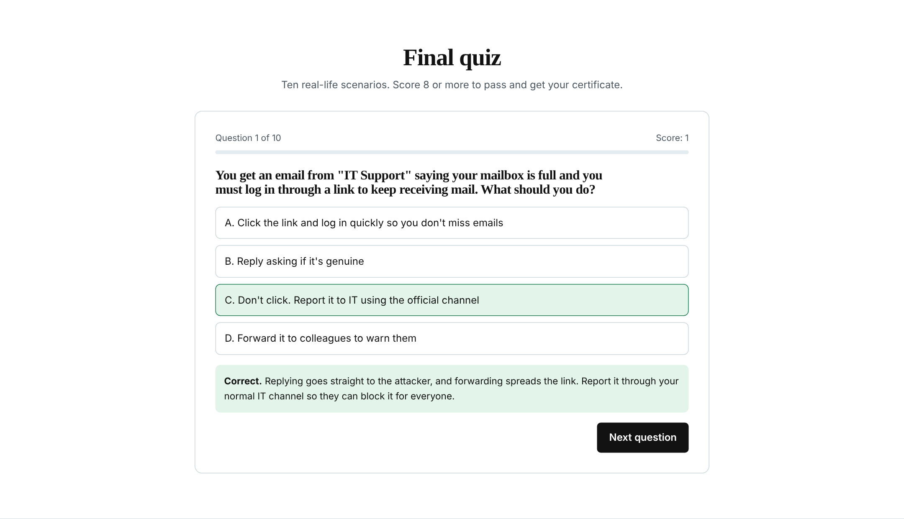
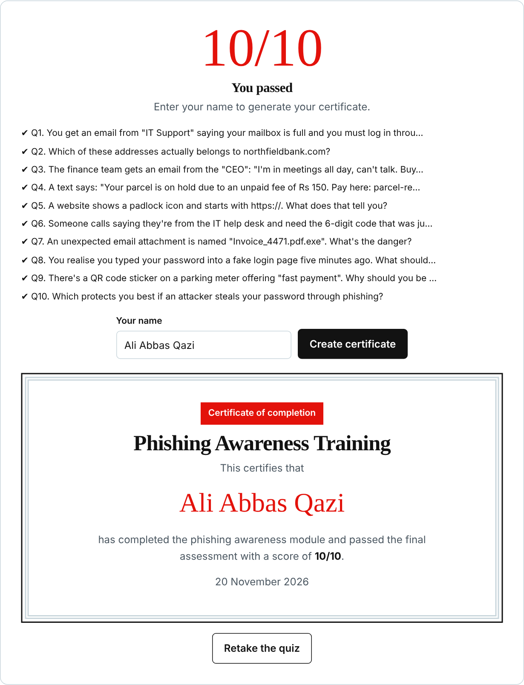

<a name="readme-top"></a>

<div align="center">

# Phishing Awareness Training Module

[](https://www.linkedin.com/in/ali-abbas-qazi/)
[](https://github.com/Ali-Abbas-Qazi)

*An interactive, self-paced web module that teaches people to recognise phishing emails, fake websites and social engineering, then tests them with a scored quiz.*

<br>

<a href="https://ali-abbas-qazi.github.io/CodeAlpha_Phishing_Awareness/">
  
</a>

**[ali-abbas-qazi.github.io/CodeAlpha_Phishing_Awareness](https://ali-abbas-qazi.github.io/CodeAlpha_Phishing_Awareness/)**

</div>

| | |
|---|---|
| **Project** | Interactive security awareness training module |
| **Format** | Single-page web module (HTML, CSS, JavaScript) |
| **Date** | November 2026 |
| **Author** | Ali Abbas Qazi |
| **Tools Used** | HTML5, CSS3, vanilla JavaScript, GitHub Pages |
| **Category** | Security Awareness · Social Engineering · Phishing Defence |
| **Live Module** | **[Open the training module ↗](https://ali-abbas-qazi.github.io/CodeAlpha_Phishing_Awareness/)** |

> [!TIP]
> **Try it yourself:** the module runs in your browser with nothing to install. **[Click here to open the live training module ↗](https://ali-abbas-qazi.github.io/CodeAlpha_Phishing_Awareness/)**

<div align="justify">

Most breaches don't start with clever code. They start with a person clicking a link, opening an attachment or trusting a phone call. This module is a short training course for non-technical users that explains how phishing works and how to spot it. Instead of slides full of bullet points, it puts the learner in front of a realistic phishing email and a set of lookalike web addresses and asks them to find the problems themselves. It ends with a ten-question scenario quiz and a certificate of completion.

The whole module is one self-contained `index.html` file with no frameworks or build step. It opens in any browser, works on phones, supports dark mode and can be hosted for free on GitHub Pages.

</div>

<div align="center">

| Lessons | Interactive Exercises | Quiz Questions | Real-World Cases | Completion Time |
|:---:|:---:|:---:|:---:|:---:|
| **6** | **3** | **10** | **3** | **~15 min** |

</div>

---

## Table of Contents

- [Objectives](#objectives)
- [Module Structure](#module-structure)
- [Interactive Features](#interactive-features)
- [Lesson Content](#lesson-content)
- [Final Quiz and Certificate](#final-quiz-and-certificate)
- [How to Run](#how-to-run)
- [Repository Structure](#repository-structure)
- [Design Decisions](#design-decisions)
- [Sources](#sources)
- [Conclusion](#conclusion)

---

## Objectives

| Objective | How This Project Covers It | Evidence |
|---|---|:---:|
| Create a presentation or online module focused on phishing attacks | A single-page online training module with seven sections and sticky navigation | Fig. 1 |
| Explain how to recognise phishing emails and fake websites | An interactive phishing email with 7 hidden red flags, an 8-point email checklist, a URL anatomy breakdown and a "which link is real?" exercise | Fig. 2, 4 |
| Educate about social engineering tactics used by attackers | 8 phishing types and 6 psychological triggers, each with an example of what it sounds like | Fig. 3, 5 |
| Provide best practices and tips to avoid falling victim | 8 everyday habits plus a 6-step plan for what to do after being phished | Fig. 7 |
| Include real-world examples and interactive quizzes | 3 documented attacks (Google and Facebook, Twitter, MGM Resorts) and a 10-question scored quiz with instant feedback and a certificate | Fig. 6, 8, 9 |

---

## Module Structure



<div align="justify">

The module opens with a hands-on exercise before any theory. Learners first try to find what's wrong with a phishing email, then the lessons explain the patterns they just saw. Each section builds on the last, and the quiz at the end only unlocks a certificate once the learner scores 8 out of 10 or more.

</div>

<p align="center">
  
</p>
<p align="center"><sub><b>Figure 1:</b> The opening screen: key statistics, the module outline and the interactive phishing email, with four red flags already found and the real link shown on hover.</sub></p>

---

## Interactive Features

| Feature | What the Learner Does | What It Teaches |
|---|---|---|
| **Phishing email inspector** | Clicks suspicious parts of a fake bank email. Each find is numbered and explained. Hovering the button reveals the real link in a status bar | Sender spoofing, Reply-To tricks, urgency, link mismatch, requests for secrets, double extensions |
| **URL anatomy and link test** | Reads a colour-coded breakdown of a malicious URL, then picks the genuine link out of four | How to find the registered domain, and why subdomains and padlocks prove nothing |
| **Scenario quiz** | Answers 10 real-life scenarios with instant feedback, then enters a name to generate a certificate | Applying everything above to emails, texts, phone calls, QR codes and attachments |

<p align="center">
  
</p>
<p align="center"><sub><b>Figure 2:</b> The email inspector with all 7 red flags found, each one numbered in the email and explained underneath.</sub></p>

---

## Lesson Content

### What Is Phishing

<div align="justify">

The first lesson defines phishing as a con rather than a hack: the attacker pretends to be someone trusted so the victim hands over credentials, money or access. It then covers the eight main forms, each with a short example: email phishing, spear phishing, whaling, business email compromise (BEC), smishing, vishing, quishing (QR code phishing) and clone phishing.

</div>

<p align="center">
  
</p>
<p align="center"><sub><b>Figure 3:</b> The eight types of phishing, each with an example of what the attack looks like.</sub></p>

### Recognising Phishing Emails and Fake Websites

<div align="justify">

The email lesson lists the eight signs from the inspector exercise as a checklist learners can keep: mismatched senders, a different Reply-To, generic greetings, urgency, misleading links, requests for secrets, risky attachments and odd spelling. It also points out that AI-written phishing is often grammatically perfect, so good writing is not a sign of safety.

The website lesson teaches the single most useful skill for spotting fake sites: reading the registered domain. A colour-coded URL shows that in `login.northfieldbank.com.account-verify.io`, the real owner is `account-verify.io` and everything before it is decoration. Learners then test themselves on four links, including a digit-for-letter swap and a hyphenated lookalike.

</div>

<p align="center">
  
</p>
<p align="center"><sub><b>Figure 4:</b> URL anatomy breakdown and the link test, with one wrong and one correct answer selected.</sub></p>

### Social Engineering Tactics

<div align="justify">

Phishing works because it targets ordinary instincts. This lesson covers the six triggers attackers rely on most (urgency, authority, fear, curiosity and reward, trust and familiarity, and helpfulness), each with a line showing what it sounds like in a real message or call.

</div>

<p align="center">
  
</p>
<p align="center"><sub><b>Figure 5:</b> The six psychological triggers behind social engineering.</sub></p>

### Real-World Cases

| Year | Target | Attack Type | Impact | Lesson |
|:---:|---|---|---|---|
| 2013–2015 | Google and Facebook | Business email compromise with fake supplier invoices | About $121 million paid out; attacker sentenced to 5 years | Verify payment requests through a known contact |
| 2020 | Twitter | Phone spear phishing of employees | 130 accounts targeted, bitcoin scam posted from 45 | IT staff never need your credentials over the phone |
| 2023 | MGM Resorts | Vishing call to the IT help desk | About $100 million reported impact, around 10 days of disruption | Help desks need strict identity checks |

<p align="center">
  
</p>
<p align="center"><sub><b>Figure 6:</b> Case studies showing that large companies fall for the same tricks.</sub></p>

### Best Practices

<div align="justify">

The last lesson turns everything into habits: pausing before clicking, verifying requests through a second channel, typing addresses instead of following links, using MFA and a password manager, never sharing one-time codes, sharing less publicly and reporting suspicious messages. Next to it is a six-step response plan for anyone who thinks they've already been phished, because acting quickly matters more than feeling embarrassed.

</div>

<p align="center">
  
</p>
<p align="center"><sub><b>Figure 7:</b> Everyday habits and the incident response steps for learners.</sub></p>

---

## Final Quiz and Certificate

<div align="justify">

The quiz uses scenarios instead of definitions, so learners have to apply what they learned rather than remember it. Questions cover a fake IT email, picking the real URL, a CEO gift card request, a parcel smishing text, what the padlock means, a help desk call asking for an MFA code, a `.pdf.exe` attachment, what to do after entering a password on a fake page, a QR code on a parking meter, and which defence best protects against stolen passwords.

Every answer shows immediate feedback explaining why it's right or wrong. The results screen lists each question with a tick or cross, and a score of 8/10 or more unlocks a certificate with the learner's name, score and date.

</div>

<p align="center">
  
</p>
<p align="center"><sub><b>Figure 8:</b> A quiz question with instant feedback after answering.</sub></p>

<p align="center">
  
</p>
<p align="center"><sub><b>Figure 9:</b> The results screen with a per-question review and the generated certificate of completion.</sub></p>

---

## How to Run

<div align="justify">

There is nothing to install. Use any one of these options:

</div>

| Option | Steps |
|---|---|
| Online | Open the [live demo](https://ali-abbas-qazi.github.io/CodeAlpha_Phishing_Awareness/) |
| Locally | Download `index.html` and open it in any modern browser |
| Clone | `git clone https://github.com/Ali-Abbas-Qazi/CodeAlpha_Phishing_Awareness.git` then open `index.html` |

> [!NOTE]
> The page loads its fonts from Google Fonts. Offline, it falls back to system fonts and everything else still works.

---

## Repository Structure

```
CodeAlpha_Phishing_Awareness/
├── index.html              # the complete training module
├── README.md
└── screenshots/
    ├── 01_module_overview.png
    ├── 02_email_red_flags.png
    ├── 03_phishing_types.png
    ├── 04_fake_website_check.png
    ├── 05_social_engineering_tactics.png
    ├── 06_real_world_cases.png
    ├── 07_best_practices.png
    ├── 08_quiz_feedback.png
    └── 09_quiz_result_certificate.png
```

---

## Design Decisions

| Decision | Reason |
|---|---|
| Hands-on exercise first, theory second | People remember a red flag they found themselves better than one they read about |
| A fictional bank (Northfield Bank) in every example | Realistic training without imitating a real company's branding |
| Scenario-based quiz questions | Tests whether learners can apply the rules, not just repeat them |
| Pass mark of 8/10 before the certificate | Makes the certificate mean something and encourages a review if needed |
| One self-contained HTML file | No server, no dependencies, easy to share, host or embed in a company intranet |
| Responsive layout, dark mode and keyboard focus styles | Usable on phones and accessible to keyboard users |

> [!WARNING]
> Every email address, domain and brand used in the exercises is fictional and exists only for training. Do not use these examples to imitate real organisations.

---

## Sources

<div align="justify">

The statistics and case studies in the module come from the following public sources:

</div>

- [Verizon 2025 Data Breach Investigations Report](https://www.verizon.com/about/node/928923): human element in about 60% of breaches; phishing as the initial access vector in 16%
- [CyberScoop](https://cyberscoop.com/facebook-google-scam-man-sentenced/): sentencing in the Google and Facebook fake invoice case
- [MacRumors](https://www.macrumors.com/2020/07/31/twitter-hack-used-spear-phishing-attack/): Twitter's confirmation of a phone spear phishing attack
- [Insurance Journal](https://www.insurancejournal.com/news/national/2024/01/31/758619.htm): the help desk vishing call behind the MGM attack

---

## Conclusion

<div align="justify">

The module covers what a non-technical user needs to stay safe from phishing: how the attacks are built, how to read an email and a URL with suspicion, why social engineering works, and what to do when something goes wrong. Building it changed how I think about awareness training. Listing warning signs is the easy part. Getting people to actually look for them is harder, which is what the email inspector and link test are for, and the scenario quiz checks whether it stuck.

A good next step would be tracking results across a team, or adding a simulated phishing campaign so people can be tested in their real inbox rather than on a training page.

</div>

---

<div align="center">

<a href="https://ali-abbas-qazi.github.io/CodeAlpha_Phishing_Awareness/">
  
</a>

<br><br>

**Ali Abbas Qazi**

[](https://www.linkedin.com/in/ali-abbas-qazi/)
[](https://github.com/Ali-Abbas-Qazi)
[](https://ali-abbas-qazi.github.io)

<a href="#readme-top">↑ Back to top</a>

</div>
